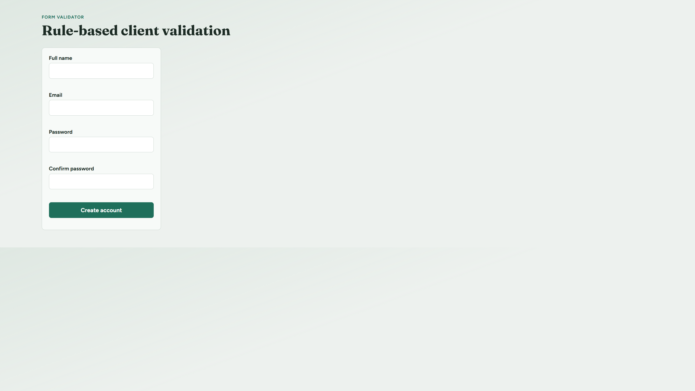

# form-validator

Small client-side validation engine with reusable rules and accessible inline errors.

## Status

Library + signup demo with unit tests and CI. No build step or CLI.

## Screenshot



## Run

```powershell
python -m http.server 5182
```

Then open http://localhost:5182

## Test

```powershell
node --check js/validator.js
node --check js/app.js
node --test test/validator.test.mjs
```

## Module

```js
import { validate, rules } from "./js/validator.js";

const errors = validate(
  { email: "a@b.co", password: "secret12", confirm: "secret12" },
  {
    email: [rules.required("Email"), rules.email],
    password: [
      rules.required("Password"),
      rules.minLength(6, "Password"),
      rules.pattern(/\d/, "Password must include a number."),
    ],
    confirm: [rules.matches("password", "Passwords")],
  }
);
```

Blank values skip non-required rules (`minLength`, `maxLength`, `email`, `pattern`). Use `required()` when presence matters.

## Built-in rules

| Helper | Purpose |
|--------|---------|
| `rules.required(label?)` | Non-empty value |
| `rules.minLength(n, label?)` | Minimum string length |
| `rules.maxLength(n, label?)` | Maximum string length |
| `rules.email` | Basic email shape check |
| `rules.pattern(regex, message?)` | Custom regex (safe with `/g`/`/y`) |
| `rules.matches(otherField, label?)` | Must equal another field |

## License

MIT
